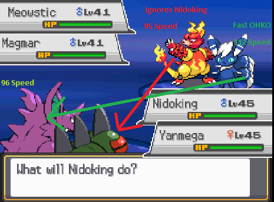

# Pokémon Hardlove Gold AI

## Contents

- [Brief summary](#brief-summary)
- [Switch AI](#switch-ai)
- [Diverting targets in Doubles](#diverting-targets-in-doubles)
- [Damaging moves](#damaging-moves)
- [Hazards](#hazards)
- [Protection and support moves](#protection-and-support-moves)
- [Field and weather moves](#field-and-weather-moves)
- [Substitute, Explosion and Memento](#substitute-explosion-and-memento)
- [Status moves](#status-moves)
- [Setup moves](#setup-moves)
- [Other status moves](#other-status-moves)
- [Recovery moves](#recovery-moves)
- [Counter moves](#counter-moves)
- [Extra details](#extra-details)

---

## Brief summary

The AI will calculate a score for every move and choose the highest scoring move to click on any given turn. If multiple moves have the same score, it randomly selects between one of them. In Double battles, the AI will calculate a score for each of its moves on each possible target, and choose the highest scoring move + target. If multiple targets have the same highest move score, the AI will randomly roll the target first, before choosing the highest move score.

The AI knows your full team's stats, moves, items and Abilities at the start of the battle. It sees accurate damage and speed, including Mega Evolution: if an AI mon is **on the field** and can Mega Evolve, it already uses the Mega's stats, Ability and typing for any calculation. It also sees Sticky Webs, if Terrain Seeds and/or Unburden would proc, Libero STAB, guaranteed critical hits, any effect that prevents moves from being usable like Encore, Choice Lock, Taunt, Throat Chop, etc.

The AI does not read player input. The only instance where the AI "cheats" is reading its sleep counter, so that the AI knows when it wakes up and can click a move or Sleep Talk/Snore.

The rest of this document will list out the possible scores for the relevant moves in the game, and the scenarios in which those scores are possible. As a general rule, the default score for non-attacking moves is **+6** (tied with the highest damage attacking move).

Lastly, the AI has a basic function to check if a move is useless. For example, if Stealth Rocks are already set, the AI will not try to click SR again. If you are paralyzed, it will not try to paralyze you again. It also never clicks moves that would fail or do nothing: moves without PP, disabled or Taunted moves, moves you are immune to (type, Ability, Levitate, Air Balloon, Grass/Overcoat/Safety Goggles against powder moves), priority moves into Psychic Terrain, Prankster status moves into Dark types, Nightmare on an awake target and so on.

### Common scores to be aware of

| Situation | Score |
|---|---|
| Highest damaging move | +6 (80%), +8 (20%) |
| Slow kill (AI kills but is slower than target) | +9 (80%), +11 (20%) |
| Fast kill (AI kills and is faster\* than target) | +12 (80%), +14 (20%) |

\*AI sees speed ties as them being faster than the player. A kill with a priority move counts as a fast kill.

---

## Switch AI

The AI in this game usually does not hard switch in battle, but it is possible in Single Battles only. In Double Battles, the AI never switches. The AI calculates a Switch-In Score for each mon in the back. For a hard switch, it factors in the highest damage the switch-in would receive on the switch.

### When the AI will not consider a switch

- AI is trapped or on its last mon
- AI has fast OHKO
- AI has slow OHKO and player does not have OHKO
- AI has at least one boosted stat or is behind a Substitute
- AI has no pivot move (U-Turn, Volt Switch, Flip Turn, Parting Shot) and is below 67% HP
- AI has no pivot move and deals more damage than it receives (in % of current HP, both with the highest roll)

### Switch chance

If the best Switch-In Score is below +3, the AI never switches. Otherwise it checks if Perish Song is active.

**If Perish Song is active**, the AI has a chance to switch with:

```
30% * (Switch-In Score - 2)
```

i.e. with a +4 Switch-In Score, the AI has a 66% chance to switch.

**If Perish Song is not active** and the Switch-In Score is +4 or higher, the AI calculates the rate to switch according to the highest damage the switch-in would receive:

```
MAX(0, (50% - damageInPercent) * 3 / 5)
```

With a +4 Switch-In Score only half of this rate is used. With +5 or higher it adds a flat 5% to the rate:

| Switch-In Score | Switch chance |
|---|---|
| +3 or lower | 0% |
| +4 | 0-15% |
| +5 or higher | 5-35% |

If the AI has a pivot move it can use, it will use the pivot move instead of hard switching, unless it would be KO'd before it moves.

### Switch-In Score

This score is also used to pick the next mon after a KO. It starts at +0, then **for each player mon on the field**:

- If the switch-in is faster:
  - Can OHKO the player mon: **+5**
  - Else, deals at least as much % as it receives: **+3**
  - Else: **+1**
- If the switch-in is slower:
  - Can OHKO the player mon and is not OHKO'd: **+4**
  - Else, deals more % than it receives: **+2**
  - Else, if it is OHKO'd: **-1**

Hard switch only:

- If the switch-in is KO'd on the switch, or is slower and takes 50% or more: **-10**
- If the switch-in holds a Mega Stone (the AI saves its Mega): **-10**
- If the switch-in takes 25% or less: **+1**

After a KO only, once:

- Wobbuffet / Wynaut that is not OHKO'd: **+2**
- Ditto that is faster: **+2**
- Zoroark that is faster: **+0 to +2** (random)

Mons that are KO'd on the switch, or slower and 2HKO'd, are effectively never picked for a hard switch.

---

## Diverting targets in Doubles



The AI will calculate the faster mon first (Mega speed included). If it sees a fast OHKO, the partner mon will completely ignore the player's mon that will be a fast OHKO.

---

## Damaging moves

### All damaging moves

AI will roll a random damage roll for all of its attacking moves\*, and the highest damaging move gets the following score:

- **+6** (~80%), **+8** (~20%)

If multiple moves kill, then they are all considered the highest damaging move and all get this score. OHKO moves (Fissure etc.) can only get the +8 if the AI has No Guard.

- If a damaging move kills:
  - If AI mon is faster, or the move has priority and AI is slower: additional **+6**
  - If AI mon is slower: additional **+3**
  - If AI has Moxie, Beast Boost, Chilling Neigh, Grim Neigh, Eelevate: additional **+1**
- If a damaging move has a high crit chance and is Super Effective on the target: additional **+2** (50%), no score boost other 50%

> \***Note:** There are a few specific damaging moves that do not have their damage rolled normally and are thus never considered the "highest damaging move".
>
> These moves are Explosion, Self-Destruct, Misty Explosion, Final Gambit, Rollout, Ice Ball, Meteor Beam, Electro Shot, damaging trapping moves (e.g. Whirlpool), Future Sight and Doom Desire.
>
> All of these moves still have a check to see if they kill the target mon. If so, the above boosts for kills still apply. They will just never get the +6 or +8 boost from being the "highest damaging move". They all also have separate AI that is listed later in this file, which stacks additively with any score boosts from kills.

### Damaging priority moves

- If AI is dead to player mon and slower, all attacking moves with priority get an additional **+11**

### Damaging trapping moves

Whirlpool, Fire Spin, Sand Tomb, Bind, Wrap, Clamp, Infestation:

- **+6** (~80%), **+8** (~20%)
- Never used if the target is already trapped, a Ghost type or holds a Shed Shell (Sand Tomb only scores if the target is grounded)

### Damaging speed reduction moves with guaranteed effect

Icy Wind, Electroweb, Rock Tomb, Mud Shot, Low Sweep:

- If this is the highest damaging move, none of the below bonuses are applied, and the move gets the usual +6 (80%) / +8 (20%) for being the highest damaging move
- If target can have its stats lowered (not Contrary, Clear Body, White Smoke, Full Metal Body, Clear Amulet):
  - If AI is slower: **+6**
  - Else: **+5**
  - If it is a Double battle and the move is Icy Wind or Electroweb: additional **+1**

### Damaging Atk/SpAtk reduction moves with guaranteed effect

Trop Kick, Skitter Smack, etc.:

- If this is the highest damaging move, none of the below bonuses are applied, and the move gets the usual +6 (80%) / +8 (20%) for being the highest damaging move
- If target can have its stats lowered:
  - If target has a move of the corresponding split (e.g. special move if AI is considering Skitter Smack): **+6**
  - Else: **+5**
  - If it is a Double battle and the move is spread: additional **+1**

### Damaging -2 SpDef reduction moves with guaranteed effect

Acid Spray:

- If the target can have its stats lowered and does not have Bulletproof, Acid Spray receives an additional **+6** on top of any standard scoring for highest damage/kill etc., regardless of whether it is the highest damaging move.

### Damaging switching moves

U-Turn, Flip Turn, Volt Switch:

- If this is not the highest damaging move and the AI has another mon to switch to, it gets **+6**, unless there is an immunity (i.e. Ground).
  - If the AI wants to switch out (see [Switch AI](#switch-ai)): additional **+3**
  - If the AI has Regenerator and is below 67% HP: additional **+1**

### Future Sight, Doom Desire

- If AI is faster than target and is KO'd by target: **+8**
- Else: **+6**
- Never used if one is already hitting the target.

> **Note:** This stacks with bonuses for kills listed in the "All damaging moves" section.

### Sucker Punch

- If AI used Sucker Punch last turn: **-20** (50%), no score change other 50%

> **Note:** Whether the Sucker failed or not last turn does not affect its score in any way.

### Fake Out, First Impression

- If it's the AI mon's first turn out (and the target is not immune to flinching for Fake Out): **+9**
- Else: never used

### Pursuit

- If Pursuit can KO player mon: **+10**
- If Pursuit cannot KO player mon:
  - If player mon is below 20% HP: **+10**
  - If player mon is below 40% HP: **+8** (50%), no score boost other 50%
- Regardless of above conditions, if AI is faster: additional **+3**

> **Note:** The bonuses for kill and AI outspeeding stack with the bonus for kill listed in the "All damaging moves" section.

### Fell Stinger

- If AI isn't at max Atk stage and Fell Stinger KOs:
  - If AI is faster: **+12**
  - If AI is slower: **+6**
- Otherwise: treated as a normal damaging move

### Focus Punch

- If player mon is incapacitated or the AI is behind a Substitute: **+2**
- Else: never used

### Dragon Tail, Circle Throw

- If AI is faster: additional **-2**

### Rollout, Ice Ball

- Always **+7**

### Meteor Beam

- If AI is holding a Power Herb: **+9**
- Else: never used (**-20**)

### Electro Shot

- If AI is holding a Power Herb or it is raining: **+9**
- Else: never used (**-20**)

---

## Hazards

### Stealth Rock

- If first turn out: **+8** (25%), **+9** (75%)
- Else: **+6** (25%), **+7** (75%)

### Spikes, Toxic Spikes

- If first turn out: **+8** (25%), **+9** (75%)
- Else: **+6** (25%), **+7** (75%)

> **Note:** If at least 1 of the corresponding spikes is up already, score is lowered by 1 always.

Hazards are never set if they are already maxed, the player has only one mon left, or the player mon (or its partner) has Magic Bounce.

### Sticky Web

- If first turn out: **+9** (25%), **+12** (75%)
- Else: **+6** (25%), **+9** (75%)

---

## Protection and support moves

### Protect, King's Shield

- Base: **+6**
- If AI is inflicted with any of the following: Poison, Burn, Paralysis, Cursed, Infatuated, Perish Songed, Leech Seeded, Yawned: additional **-1**
- If player mon is inflicted with any of the above: additional **+1**
- If it's AI mon's first turn out and it is a double battle: additional **-1**
- If it's AI mon's first turn out, it holds a Toxic Orb and has Poison Heal: additional **+1**

AI will not protect if they die of secondary damage afterwards (weather, status, etc.), if the player mon has Unseen Fist or Piercing Drill, or if the AI has Truant.

- If AI used protect last turn, 50% chance to never use protect this turn (**-20**).
- If AI used protect last 2 turns, it never uses protect this turn.

Other Protect-like moves like King's Shield have no unique AI, and are equivalent to Protect.

### Endure

- If player mon is faster and can KO the AI: **+6**
  - If AI holds a Berry: additional **+2**
  - If AI is inflicted with any of the statuses listed for Protect: additional **-1**
- Same rules as Protect for using it multiple turns in a row and for dying to secondary damage.

### Role Play

- If the AI's partner has Huge Power or Pure Power, and the AI mon doesn't: **+9** (75%), **+12** (25%)

### Skill Swap (on partner)

- For a few specific combos (e.g. giving Truant/Slow Start away, Prankster to Breloom, Technician/Flash Fire to Durant): **+6** (50%), **+9** (50%)

### Shadow Sneak, Aqua Jet, Ice Shard, Mach Punch, Bullet Punch, Vacuum Wave, Quick Attack

Special case for doubles here.

- If their partner has Weakness Policy and this move is super effective on the partner, these get **+6** (25%), **+9** (50%), **+12** (25%) when used on the partner.

### Magnitude, Earthquake

Special case for doubles here.

- If their partner isn't grounded or has Telepathy: additional **+2**
- Else if partner will be hit by EQ and it is super effective on it: additional **-10**
  - Note that this check doesn't happen if partner is immune to EQ, so Crobat for example never causes an EQ score reduction.
- Else if partner will be hit by EQ and it is neutral on it: additional **-3**
- Else (partner resists it): additional **+2**

### Imprison

- If player mon has at least one move in common with AI mon: **+9**
- If the player mon is already Imprisoned: never used (**-20**)

### Baton Pass

- If AI has a mon alive to BP into, and AI is either behind a Substitute or has a stat raised (or both): **+9**
- If AI mon is last mon out: never used (**-20**)
- If AI has a mon alive to BP into, but has no Substitute or stat increases: **+0**

### Tailwind

- If AI mon or its partner are slower than any player mon on the field: **+9**
- Else: **+5**
- If Tailwind is already up on the AI's side: **-20**

### Trick Room

- If AI mon or its partner are slower than any player mon on the field: **+10**
- Else: **+5**
- If Trick Room is already up: **-20**

### Gravity

- **+6**, never used if Gravity is already up

### Helping Hand

- **+6** (50%), **+8** (50%)
- AI will not use Helping Hand if its partner is also using Helping Hand, its partner is using a status move, or its partner is ignoring its target.

### Follow Me, Rage Powder

- In doubles, if the partner is alive: **+6** (~80%), **+8** (~20%)
- Never used in singles, or against a target with Stalwart or Propeller Tail.
- Rage Powder is also never used against a target that is immune to powder moves (Grass type, Overcoat, Safety Goggles).

### Heal Pulse, Pollen Puff, Milk Drink (on partner)

- If the AI isn't slower than the player mons and its partner is at 50% HP or lower: **+7**

### Decorate

- **+6** (50%), **+8** (50%)
- Additional **-2** if the partner's Attack or Sp. Atk is +2 or higher

### Coaching

Only used in Double battles:

- **+6** (50%), **+8** (50%)
- Additional **-1** if the partner's Attack is +2 or higher, another **-1** if its Defense is +2 or higher

### Acupressure (on partner)

- **+6** (50%), **+8** (50%)

### Final Gambit

- If AI mon is faster and has at least as much current HP as the player mon: **+8**
- If above is not true, and AI is faster and dies to player mon: **+7**
- Else: **+6**
- Never used if the target is immune.

---

## Field and weather moves

### Electric/Psychic/Grassy/Misty Terrain

- If AI holding Terrain Extender: **+9**
- Else: **+8**
- Never used if the same Terrain is already up.

### Rain Dance, Sunny Day, Sandstorm, Hail, Snowscape

- If the AI mon benefits from the weather: **+9**

  | Weather | Benefits |
  |---|---|
  | Rain | Swift Swim, Rain Dish, Hydration, Dry Skin |
  | Sun | Fire type, Solar Power, Chlorophyll |
  | Sand | Rock, Ground or Steel type, Sand Force, Sand Rush, Sand Veil |
  | Hail/Snow | Ice type, Ice Body, Snow Cloak, Slush Rush |

- If the AI holds the matching rock (Damp Rock etc.): additional **+1**
- Never used if the weather is already up.
- Like setup moves, these get no bonus if a player mon can KO the AI (see [General setup](#general-setup)).

### Light Screen, Reflect

- Starts at **+6**
- If player mon has a move that corresponds with the screen (e.g. physical move for Reflect):
  - If AI mon has Light Clay: additional **+1**
  - Another additional **+1** is applied 50% of the time
- In summary: +6 base, can be +7 or +8 depending on player moves, Light Clay being held, and RNG
- Never used if the screen is already up.

### Aurora Veil

Only used in Snow, and not if Aurora Veil is already up.

- Starts at **+6**
- If AI mon has Light Clay: additional **+1**
- Additional **+2** is applied 50% of the time

---

## Substitute, Explosion and Memento

### Substitute, Shed Tail

- Starts at **+6**
- If player mon is asleep: additional **+2**
- If player mon is Leech Seeded and AI mon is faster: additional **+2**
- Regardless of above conditions: additional **-1** (50%), no score change other 50%
- If player mon has a sound-based move that would hit the AI (the AI doesn't have Soundproof and the player mon isn't Throat Chopped): additional **-8**
- If AI is below 50% HP, already behind a Substitute, or the player mon has Infiltrator: never used (**-20**)

### Explosion, Self Destruct, Misty Explosion

- If AI mon is at less than 10% HP: **+10**
- Else if AI mon is at less than 33% HP: **+8** (~70%), **+0** (~30%)
- Else if AI mon is at less than 66% HP: **+7** (50%), **+0** (50%)
- Else: **+7** (~5%), **+0** (~95%)

AI will not use a Boom move if the target is immune or any mon on the field has Damp (unless the AI has Mold Breaker).

### Memento

- If AI mon is at less than 10% HP: **+16**
- Else if AI mon is at less than 33% HP: **+14** (~70%), **+6** (~30%)
- Else if AI mon is at less than 66% HP: **+13** (50%), **+6** (50%)
- Else: **+13** (~5%), **+6** (~95%)

AI will not use Memento if the AI is on its last mon.

---

## Status moves

### Thunder Wave, Stun Spore, Glare, Nuzzle

- If one of the following conditions are true: **+8**
  - Player mon is faster than AI mon
  - AI mon has Hex or a move that flinches (and the target can be flinched)
  - Player mon is infatuated or confused
- Else, none of the above conditions are met: **+7**
- Regardless of above conditions: additional **-1** (50%), no score change other 50%

### Will-o-Wisp

- Starts at **+6**
- ~33% of the time, the following conditions are checked:
  - If target has a physical attacking move: additional **+1**
  - If AI mon or its partner has Hex: additional **+1**
- The other ~67% of the time: no other bonuses, so just +6

### Trick, Switcheroo

- If AI is holding a Toxic Orb or Flame Orb and the target can get that status: **+6** (50%), **+7** (50%)
- If AI is holding one of the following: Iron Ball, Lagging Tail, Sticky Barb: **+7**
- Never used if neither mon holds an item, or the target has Sticky Hold.

### Yawn, Dark Void and all other non-damaging sleep moves (i.e. Grasswhistle, Sing)

- Starts at **+6**
- Sleep moves (not Yawn) get an additional **+2** if the AI has Prankster
- 25% of the time, AI considers the following conditions (assuming it sees no kill):
  - If player mon can be put to sleep (no sleep-preventing abilities, no pre-existing status, no terrain, etc.): additional **+1**
  - If AI has Dream Eater or Nightmare, and player does not have Snore or Sleep Talk: additional **+1**
  - If AI or AI's partner has Hex: additional **+1**
- The other 75% of the time: no additional bonuses, so just +6

### Poisoning moves

- Starts at **+6**
- ~33% of the time, if the AI cannot KO the player mon, the following checks are applied:
  - If player mon can be poisoned and is above 20% HP:
    - If AI mon has Hex, Venom Drench, Venoshock or the ability Merciless and the AI takes less than 50% from the player mon: additional **+2**
- The other ~67% of the time: no additional bonus, so just the base +6

### Confusing moves (Confuse Ray, Swagger, Flatter, etc.)

- Starts at **+6**
- If player mon is paralyzed or infatuated: additional **+2**
- Never used if the target is already confused, has Own Tempo or is behind Safeguard.

### Attract

- Starts at **+6**
- If player mon is paralyzed or confused: additional **+2**
- Never used if the target is already infatuated, has Oblivious, or one of the mons is genderless or both are the same gender.

### Leech Seed

- Starts at **+6**
- If player mon cannot KO the AI and is above 20% HP: additional **+1**, and another **+1** 50% of the time
- If player mon is infatuated or confused: additional **+1**
- If player mon is poisoned, burned or paralyzed: additional **+1**
- Never used if the target is already seeded, a Grass type or has Magic Guard.

### Sleep Talk, Snore

- If the AI mon is asleep and will still be asleep when it moves (the AI knows its sleep counter, including Early Bird and Uproar): **+24**
- Else: never used (**-20**)

---

## Setup moves

### General setup

Dragon Dance, Calm Mind, etc.\*

- If any player mon can KO AI, or the player mon can force a switch (Roar, Whirlwind, Dragon Tail, Circle Throw), the AI mon gets no bonus for setup moves at all.
- If player mon has Unaware, the AI mon still has a 25% chance to score setup normally.

\*Full list of moves that fall into this category:

> Swords Dance, Howl, Nasty Plot, Tail Glow, Growth, Work Up, Hone Claws, Dragon Dance, Shift Gear, Tidy Up, Victory Dance, Shell Smash, Clangorous Soul, Belly Drum, Bulk Up, Coil, Curse (non-Ghost), Calm Mind, Quiver Dance, Iron Defense, Acid Armor, Barrier, Cotton Guard, Harden, Amnesia, Cosmic Power, Defense Curl, Charge, Stuff Cheeks, Stockpile, Agility, Rock Polish, Autotomize, Focus Energy, Psych Up, evasion boosting moves, Ingrain, Aqua Ring, Geomancy, weather moves, and Power-Up Punch / Charge Beam / Trailblaze / Rapid Spin when they are not the highest damaging move.

### Offensive setup

Swords Dance, Howl, Nasty Plot, Tail Glow, Growth, Work Up, Hone Claws, Dragon Dance, Shift Gear, Tidy Up, Victory Dance, Power-Up Punch, Charge Beam:

- Starts at **+6**
- If AI is already at +2 or higher in Attack or Sp. Atk: additional **-2**, and another **-1** at +3 or higher
  - Dragon Dance, Shift Gear, Tidy Up, Victory Dance: the same -2/-1 also apply if the AI is already faster
- If player mon is incapacitated (frozen with no thawing move, asleep, recharging, loafing around due to Truant): additional **+3**
- If the player mon has no active Focus Sash/Sturdy:
  - If AI is faster, it is a single battle and no player mon can KO the AI: additional **+2**
  - If AI takes less than 1/3 of its HP from the player mon: additional **+3**, and another **+1** if AI is faster
- If AI is slower and is 2HKO'd by player mon: additional **-5**
- If AI is 2HKO'd by player mon: additional **-2** (50%)

### Defensive setup

Iron Defense, Acid Armor, Barrier, Cotton Guard, Harden, Amnesia, Cosmic Power, Defense Curl, Charge, Stuff Cheeks, Stockpile:

- Starts at **+6**
- Defense boosting moves are only used if the player mon has a physical move, Sp. Def boosting moves only if it has a special move.
- If AI is already at +2 or higher in Defense or Sp. Def: additional **-3**, and another **-1** at +3 or higher
- If player mon is incapacitated: additional **+2**
- If AI is slower and is 2HKO'd by player mon: additional **-5**
- If AI takes less than 1/3 of its HP from the player mon: additional **+3**, and another **+1** if AI is faster

### Coil, Bulk Up, Curse, Calm Mind, Quiver Dance

- Starts at **+6**
- Additional **-2** if already at +2 or higher in one of the boosted stats, another **-1** at +3 or higher

These moves are treated as "Defensive Setup" or "Offensive Setup" depending on the moves of the player's mon on the field.

If the move boosts physical stats (Coil, Bulk Up, Curse), then the AI checks if the player mon has a physical attacking move and no special attacking moves. If this is true, then these moves are treated as "Defensive Setup". If the player has no physical attacks or at least one special attack, then these moves are treated as "Offensive Setup".

Calm Mind and Quiver Dance are treated the same, except with special and physical swapped. So if the player mon has a special attacking move and no physical attacking moves, CM/QD are treated as "Defensive Setup". Otherwise, they are considered "Offensive Setup".

See the sections above for how the AI scores [Defensive](#defensive-setup) and [Offensive](#offensive-setup) setup.

### Agility, Rock Polish, Autotomize

Also Trailblaze and Rapid Spin when they are not the highest damaging move.

- If AI is slower than player mon: **+7**
- Else: never used (**-20**)

### Shell Smash, Clangorous Soul

- Starts at **+6**
- If player mon is incapacitated (frozen, asleep, recharging): additional **+3**
- If AI is faster:
  - If AI holds a White Herb or takes less than 50% from the player mon: additional **+2**
  - Else: additional **-2**
- If AI mon's Attack or Sp. Atk is +2 or higher: never used (**-20**)
- Clangorous Soul is never used below 1/3 HP.

### Belly Drum

- Starts at **+4**
- If player mon is incapacitated (frozen, asleep, recharging): additional **+5**
- If above is not true, AI is above 50% HP and player mon cannot KO AI mon after a Belly Drum\*: additional **+4**
- Never used at 50% HP or less, or if the AI is already at +6 Attack.

\*Note: AI sees if it is holding a Sitrus Berry and takes that into account.

### Focus Energy

- If AI has Super Luck/Sniper, or is holding Scope Lens: **+7**
- Else: **+5**
- AI will not use Focus Energy if the player mon has Shell Armor or Battle Armor, or if the AI already has Focus Energy.

### Laser Focus

- **+6**
- Never used while Laser Focus is still active on the AI, or if the target can't be critted (Shell Armor or Battle Armor unless the AI has Mold Breaker, Lucky Chant on the player's side).
- While Laser Focus is active, the AI's damage calc counts its next attack as a critical hit.

### Double Team, Minimize and other evasion boosting moves

- Starts at **+6**
- If AI is already at +1 evasion or higher: additional **-1**
- Else, if AI takes less than 50% from the player mon: additional **+2**
- If player mon is incapacitated: additional **+2**
- Never used if the player mon has No Guard or AI is at max evasion.

### Psych Up

- If the player mon has any stat boosts: **+5**, plus the number of boosted stages if it is more than 1

### Ingrain, Aqua Ring

- **+6**, never used if already active

### Geomancy

- If AI is holding a Power Herb: **+9**
- Else: never used (**-20**)

### Note for Pokémon with Contrary

Attacking moves that lower the user's stats (Overheat, Leaf Storm, Superpower, Close Combat, etc.) are treated as setup moves when used by Pokémon with Contrary. This only applies if the move is not the highest damaging move. In this case:

- If player mon is incapacitated: additional **+3**
- If AI is faster: additional **+3**
- If AI takes less than 1/3 of its HP from the player mon: additional **+3**, and another **+1** if AI is faster

If the attacking move is the highest damaging move already, its score is not affected by Contrary and the move is simply treated as a normal damaging move.

These "setup" moves are a little unique and do not have the checks that normal setup moves have. Contrary Overheat, Leaf Storm, and Superpower can be used against Unaware mons, and can also be used even if the AI mon is threatened with an OHKO.

---

## Other status moves

### Destiny Bond, Curse (Ghost type)

- If AI is faster and dies to player mon: **+6** (~80%), **+7** (~20%)
- If AI is slower: **+5** (50%), **+6** (50%)

### Disable

- If the player mon is locked into a move by a Choice item: **+6**, and another **+3** if the AI is faster
- Else, if the player mon is faster and holds a Choice item: **+6**, and another **+3** if a player mon can KO the AI
- Never used if the player mon is already Disabled.

### Taunt

- If AI is faster and the player mon has one of these moves that would do something this turn: **+9**
  - Defog (and the player's side has hazards)
  - Tailwind (and the player has no Tailwind up)
  - Trick Room (and Trick Room is not up)
- Else, if the player mon has a status move it can use: **+6**
- Else: **+5**
- Never used if the target is already Taunted, has Oblivious or Aroma Veil, or its partner has Aroma Veil.

### Encore

- If AI is faster and Encore is encouraged\*: **+7**
- Else: **+6** (50%), **+5** (50%)
- Wobbuffet instead gets **+7** if Encore is not encouraged.
- AI will not Encore if target is already Encored, is locked by a Choice item, or if it is the target's first turn out (there is no move for the AI to Encore).

\*The AI looks at the target's last used move and checks if it is one that should be Encored. The list of moves that should be Encored is very long and I will not be listing them all here, but it mostly boils down to non-damaging moves.

### Parting Shot

- If the AI has another mon to switch to: **+6**
  - If the AI wants to switch out (see [Switch AI](#switch-ai)): additional **+3**
  - If the AI has Regenerator and is below 67% HP: additional **+1**
- Never used if the target can't have its stats lowered.

### Roar, Whirlwind

- If the player has more than one mon left: **+6** (50%), **+7** (50%)
- Else: never used (**-20**)
- Never used if the target has Suction Cups or is Ingrained.

### Stat lowering status moves (Growl, Charm, Fake Tears, Screech, etc.)

Attack lowering moves are only used if the player mon has a physical move, Sp. Atk lowering moves only if it has a special move.

- Attack / Sp. Atk lowering: **+5**
  - If neither mon 2HKOs the other:
    - Additional **+1** if the target can have its stats lowered (and has no Hyper Cutter for Attack lowering moves)
    - Additional **-1** if the player mon is faster
- Defense / Sp. Def lowering:
  - If neither mon 2HKOs the other and the target can have its stats lowered: **+7**
- Accuracy / evasion lowering: **+5**
  - Additional **+1** if the target can have its stats lowered
  - Additional **-1** if the player mon is faster

### Venom Drench

Only used if the target is poisoned and has an attacking move that isn't already lowered:

- **+5**
- Additional **+1** if the target can have its stats lowered
- Additional **-1** if the player mon is faster

### Recycle

- **+6** if the AI has no item and its last used item was a Berry Juice, else never used

### Ion Deluge

- Only used in doubles: **+6**, never used if the target is a Ground type or has Volt Absorb

### Soak

- **+6**, never used if the target is already a Water type

---

## Recovery moves

### Recover, Slack Off, Heal Order, Soft-Boiled, Roost, Strength Sap, Wish

- If AI [decides it should recover](#should-ai-recover-function): **+7**
- Else: **+5**
- AI will not use Recovery moves if at full (**-20**), or at 85% or higher (**-6**)
- Wish is never used if a Wish is already pending.
- While the AI is under Heal Block, it never uses healing moves (**-20**).

### Weather-based recovery moves (Morning Sun, Synthesis, Moonlight, Shore Up)

- If boosting weather is active (sun, or sand for Shore Up): **+7** if AI decides it should recover, **+5** if not
- If no weather affects the move, it heals 50% and becomes identical to the Recovery Moves listed above: **+7** if AI decides it should recover, **+5** if not
- In weather that weakens the move (rain, sand, hail, snow): **+5**
- AI will not use Recovery moves if at full (**-20**), or at 85% or higher (**-6**)

### Rest

- If AI decides it should recover:
  - If one of the following conditions is true: **+8**
    - AI is holding an item that would cure Sleep (Lum Berry, Chesto Berry)
    - AI has Sleep Talk or Snore
    - AI has Shed Skin/Early Bird
    - AI has Hydration and it is raining
    - AI's partner has Healer
  - If none of the above conditions are true: **+7**
- If AI decides it should not recover: **+5**
- Never used if Rest would fail: AI is already asleep, Uproar is active, AI has Insomnia, Vital Spirit, Comatose, Sweet Veil (or its partner has it), Leaf Guard or Shields Down, or it is grounded in Electric or Misty Terrain.

---

## Counter moves

### Metal Burst

- Starts at **+6**
- If AI has an active Sturdy/Focus Sash: additional **+2**
- If AI is faster: additional **-1** (25%), no score change other 75%
- If player has status moves it can use: additional **-1** (25%), no score change other 75%

### Counter, Mirror Coat

- Starts at **+6**
- If player mon can KO AI (and AI doesn't have Sturdy/Sash active): additional **-20**
- If target only has moves of the corresponding split (e.g. only physical moves for Counter scoring): additional **+2**
- If AI mon has an active Sturdy/Focus Sash: additional **+2**
- Regardless of above, if AI is faster: additional **-1** (25%), no score change other 75%
- Regardless of above, if player has status moves it can use: additional **-1** (25%), no score change other 75%

---

## Extra details

### Should AI Recover function

Recovery %:

| Move | Recovery % |
|---|---|
| Standard recovery moves (Recover, Slack Off, Heal Order, Roost, Strength Sap, Wish) | 50% |
| Weather-based recovery moves (Morning Sun, Synthesis, Moonlight) | 67% in sun, 25% in rain, sand, hail or snow |
| Shore Up | 67% in sand |
| Rest | 100% |

- If AI mon is Toxic'd (not for Rest): returns **False**
- If player mon does more damage than would be healed off: returns **False**
  - Note that this calculation uses the Recovery % listed above.
- If AI is faster:
  - If player mon can kill AI mon, but cannot after AI mon uses recovery move: returns **True**
  - If player mon cannot kill AI mon:
    - If AI mon is below 66% and above 40%: returns **True** (50%), **False** (50%)
    - If AI mon is below 40%: returns **True**
- If AI is slower:
  - If AI is below 70% HP: returns **True** (75%), **False** (25%)
  - If AI is below 50% HP: returns **True**
- If none of the above cases are true, then this function defaults to return **False**.
